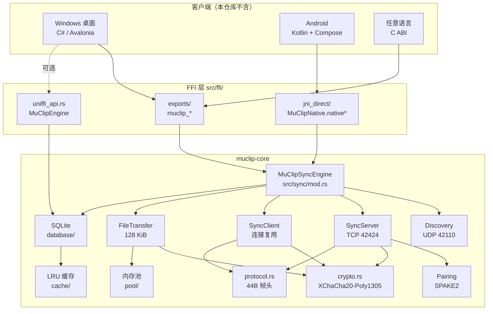

<div align="center">
  
  <h1>MuClip Core</h1>
  <p><strong>局域网内零配置的剪贴板同步与加密文件互传引擎</strong><br/>
  <sub>一个 Rust 核心库，供 Windows / Android / 任意支持 C ABI 的语言复用</sub></p>

  <p>
    
    
    
    
  </p>

  <p>
    <a href="#-这东西解决什么问题">是什么</a> •
    <a href="#-核心特性">特性</a> •
    <a href="#-架构">架构</a> •
    <a href="#-快速开始">快速开始</a> •
    <a href="#-协议速查">协议</a> •
    <a href="#-安全模型">安全</a> •
    <a href="#-构建">构建</a>
  </p>
</div>

---

## 🎯 这东西解决什么问题

局域网里两台设备想互传一段文字，现有方案要么依赖云（数据出境）、要么依赖第三方 App（信任成本）、要么配置繁琐（Syncthing 要建共享目录）。MuClip 的做法是把这层能力做成**一个可嵌入的原生库**：

- **零配置发现**：同一子网内自动互相看见，不用输 IP、不用扫码、不用装中心服务。
- **配对即信任**：6 位 PIN 走 SPAKE2 握手，PIN 从不传输；配对关系存在本地，谁配对谁解密。
- **直连 P2P**：没有中继、没有云、没有"账号"。数据只在两台已配对设备之间走。
- **可嵌入**：核心是 `rlib` + `cdylib`，Windows 走 C ABI，Android 走 JNI，其余语言走 C ABI 或 UniFFI。

> 定位是**引擎**而不是成品 App。仓库里没有 UI —— 官方客户端各自嵌这一份核心：[小沐 OCR](https://github.com/katomegumi1999/ShawMuOCR)（Windows / C# + Avalonia，已发布）与 MuClip-Android（Android / Kotlin + Compose）。

| 能力 | 实现方式 |
| :--- | :--- |
| 剪贴板同步 | 文本内容 + 类型 + SHA-256 指纹，多端并发直推 |
| 设备发现 | UDP 42110 组播 + 子网定向广播 + 单播回应 + TCP 心跳兜底 |
| 配对 | SPAKE2 (Ed25519Group) + 6 位 PIN，单次性握手状态 |
| 加密 | XChaCha20-Poly1305，24 字节扩展 nonce，帧头前 16 字节作 AAD |
| 文件互传 | 128 KiB 分块原位 AEAD + 全文件 SHA-256 + `.tmp` 原子落盘 |
| 本地存储 | 嵌入式 SQLite（历史去重 / 全文搜索 / 过期清理）+ LRU 内存热缓存 |
| 跨语言 | C ABI（`muclip_core.dll`）、JNI（`libmuclip_core.so`）、UniFFI |

---

## ✨ 核心特性

**⚡ 高吞吐流式文件传输**

- 固定 **128 KiB** 分块，单块独立 AEAD，校验失败可精确定位到块序号。
- 内存池租借 + 原位（in-place）加解密，单块零额外分配。
- 接收端 1 MiB `BufWriter` 缓冲，写满 `.tmp` 后校验总块数 / 总字节 / 全文件 SHA-256，才原子重命名。
- 支持实时进度、瞬时速率、双向随时取消；已提供 `examples/bench_transfer.rs` 可复现基准。

**🔄 三层设备发现，广播丢包也不掉线**

1. UDP `42110` 组播 `224.0.0.251` + 受限广播 + 逐网卡子网定向广播，前两轮 2 秒一轮（尽快建链），之后 5 秒一轮（省电、降噪）。
2. 收到对端信标即**单播反向回应**（同 IP 1 秒节流），解决单向广播被交换机丢弃的问题。
3. UDP 超 5 秒没动静，自动转 TCP `42424` 发 `MSG_HEARTBEAT` 兜底；连续 30 秒无响应才判定离线。

**🛡️ 严格配对的加解密边界**

- PIN 只进 SPAKE2 的密码学承诺，**明文永不上线**；被动监听者无法离线暴力枚举 PIN。
- 握手状态单次性消费（`take()`），失败 3 次（`MAX_PIN_ATTEMPTS`）即断开，重试必须换新 challenge 与新的 SPAKE2 临时点。
- 帧头 `[Magic|Version|MsgType|Flags|Sequence]` 这 16 字节注入 Poly1305 作为 AAD —— 篡改消息类型或序号会直接验签失败，堵住类型混淆与重放绕过。

**🚫 不做中继，不做扩散**

- 设备 A 收到 B 的消息，只写本地，**绝不转发**给 A 的其他配对设备。消除"配一台、全网扩散"的链式泄露。
- 无中心服务器、无 NAT 穿透中继。跨网段请自备端口映射（内置静态端点支持 FRP 等 TCP 转发）。

**🗄️ 本地存储与热缓存**

- SQLite 自动去重（Upsert）+ 模糊搜索 + 过期清理 + 分页。
- 叠一层 LRU 内存池（默认 100 条 / 5 MB），退出回写，降低磁盘 I/O。
- 常用语支持**时间规则**（起止时间、插入位置、追加文本）与规则模板。
- 库文件可选用 **SQLCipher 4 加密落盘**（`--features sqlcipher`）；默认构建保持明文，不为不需要的人增加 OpenSSL 编译负担。

**💾 单文件加密备份（`.mubc`）**

- 全量归档历史、常用语、条件规则、规则模板与配置项，打成**一个自包含文件**，换机/重装一条命令复原。
- 保护口令由用户自设，与库密钥**分离**：PBKDF2-HMAC-SHA256（10 万轮）派生 256 位密钥，XChaCha20-Poly1305 加密。
- 68 字节文件头（`magic` / 版本 / PBKDF2 轮数 / 32B salt / 24B nonce）**整体作为 AAD**，改版本号或轮数参数即验签失败，堵住降级与参数混淆攻击。
- 导入两种模式：**增量合并去重**（默认，平滑并入现有数据）与**完全覆盖**（清空后还原）；写盘先落 `.tmp_backup` 再原子 `rename`，中途断电不留半个坏文件。
- 刻意**排除 `device_id`**：恢复备份不会顶掉目标机的设备身份，避免两台机器 ID 撞车导致同步错乱。

**🔌 一套核心，两端接入（非托管原生内存，零解释器/GC抖动）**

- **纯非托管执行**：全部网络 I/O、TCP 连接池、X25519 会话状态与 SQLite 均在 Rust 原生堆运行，完全独立于 C# CLR 与 Android ART 虚拟机，免受 GC 停顿与解释器性能损耗。
- **C ABI 零拷贝（Windows / C#）**：通过 `NativeBufferLease` 与 `BinarySpanReader` 针对内存池缓冲区切片，读写不经过托管堆，零跨语言深拷贝。
- **JNI 直连（Android / Kotlin）**：支持 `DirectByteBuffer` 零拷贝堆外直传，底层线程独立保活。
- **解耦无感升级**：上层只需管理 UI 与长期密钥回灌，底层协议与加解密全黑盒升级，替换 `.dll` / `.so` 即可无感享用最新特性。

---

## 🏗 架构



---

## 🚀 快速开始

### 作为 Rust 库

```toml
[dependencies]
# 尚未发布到 crates.io，先走 git
muclip-core = { git = "https://github.com/katomegumi1999/MuClip" }

# 本地同时开发核心与客户端时，改用路径依赖
# muclip-core = { path = "../MuClip" }
```

```rust
use std::sync::Arc;
use muclip_core::{MuClipSyncEngine, SyncConfig};

// 1. 启动引擎（端口填 0 表示用默认 42424 / 42110）
let engine = MuClipSyncEngine::start(SyncConfig {
    device_id: "pc-workstation-01".into(),
    device_name: "工作站".into(),
    device_type: "windows".into(),
    sync_port: 0,
    discovery_port: 0,
    pairing_pin: "483920".into(), // 6 位一次性 PIN，配对完成后可换新值
})?;

// 2. 注册回调：收到对端剪贴板
engine.on_clipboard_received(Arc::new(|payload| {
    println!("来自 {}: {}", payload.source_device_name, payload.content);
    // 注意：此处由调用方决定是否写入系统剪贴板
}));

// 3. 广播本地剪贴板（返回成功送达的设备数）
let delivered = engine.broadcast_clipboard("hello lan", "text");

// 4. 发文件（支持手动端点，便于跨网段／FRP 映射）
engine.send_file("192.168.1.20:42424", "C:/tmp/demo.zip")?;

// 5. 退出
engine.stop();
```

> 完整 API 见 `cargo doc --open`；`src/sync/mod.rs` 是能力清单的来源。

> ⚠️ **配对密钥必须自己落盘并回灌**。`add_paired_device` 支持六段格式：
> `device_id|ip|port|name|type|peer_key_hex`，第 6 段是 SPAKE2 派生的两两密钥。
> 配对成功回调（`on_pair_success` / `muclip_sync_set_pair_success_callback`）会带回这个 hex，
> **请保存并在下次启动时带上**。漏传不会报错 —— 会静默回落到 `derive_key(启动时的 key 材料)`，
> 结果是解密失败（两端长期密钥不同）或用弱密钥通信（两端同为 6 位 PIN）。
> 行为由 `tests/restart_key_lifecycle.rs` 三个用例钉住。

### 本地存储（UniFFI 路径）

```rust
use muclip_core::MuClipEngine;

let engine = MuClipEngine::new_in_memory()?;          // 或 new("path/to.db")
engine.add_history("一段文本".into())?;
let items = engine.query_history(20)?;
let analysis = muclip_core::analyze_content("https://example.com");
assert_eq!(analysis.content_type, muclip_core::ContentType::Url);
```

### C ABI（Windows / C# / C++）

```c
// muclip_core.dll
void* core    = muclip_core_new("C:/data/muclip.db");
int64_t id    = muclip_core_add_history(core, "hello");
char* json    = muclip_core_query_history(core, 20);   // 调用方负责 muclip_core_free_string

void* sync    = muclip_sync_start("dev-01", "工作站", "windows", 0, 0, "483920");
char* peers   = muclip_sync_get_active_peers(sync);    // JSON 字符串

// 加密备份：返回 {"history_count":..,"phrase_count":..,...} 的统计摘要，同样需 free_string
char* exported = muclip_core_export_db(core, "D:/backup/2026-10-23.mubc", "用户自设口令");
char* restored = muclip_core_import_db(core, "D:/backup/2026-10-23.mubc", "用户自设口令", 0); // 0=增量合并 1=完全覆盖

// 静态加密状态三态查询：1 已加密 / 0 明文 / -1 句柄无效
int32_t encrypted = muclip_core_is_encrypted(core);

// 零拷贝路径：写入内存池的租借缓冲区（Little-Endian 二进制），用完必须 release
const uint8_t* ptr; size_t len;
uint64_t lease = muclip_sync_get_active_peers_pooled(sync, &ptr, &len);
muclip_pool_release(lease);
```

结构体布局与内存所有权约定以 `src/ffi/exports/` 下的文档注释为准，每个导出函数都标注了由谁释放。

### Android（JNI）

```kotlin
// MuClipNative 声明为 external fun；JNI 符号为 Java_com_muclip_core_MuClipNative_native*
val handle = MuClipNative.nativeStartSync(deviceId, "手机", "android", 42424, pin)

// 零拷贝广播：直接把 DirectByteBuffer 的地址交给 Rust，不经过 Java 堆
MuClipNative.nativeBroadcastClipboardZeroCopy(handle, bufferPtr, byteCount, "text")

MuClipNative.nativeStopSync(handle)
```

零拷贝 `DirectByteBuffer` 路径的约定见 `src/ffi/jni_direct/` 模块注释。

> **Android 后台剪贴板约束**：后台收到推送时**不要**直接调用 `ClipboardManager.setPrimaryClip`（Android 10+ 会静默失败）。正确做法是落库并登记待写入项，等用户回到前台再写入。

---

## 🔍 诊断日志

Windows 客户端是 GUI 程序，用户双击启动时**没有控制台**，`eprintln!` 的字节写进一个不存在的句柄、静默丢失——真实机器上的故障因此拿不到任何线索，而这类问题在开发机上永远不会复现。核心内置了一条零依赖的日志通道来解决它。

三层设计，宿主按需取用：

| 能力 | 说明 |
| :--- | :--- |
| **环形缓冲** | 最近 512 条常驻内存。**不需要任何配置就已经在记录**，出问题后整段取走即可 |
| **外部回调** | `muclip_diag_set_sink()` 实时推送，C# 写文件、Kotlin 写 logcat |
| **stderr 兜底** | 开发期直接看；GUI 宿主可用 `muclip_diag_set_stderr(0)` 关掉 |

```c
// 方式一：事后取证（零改动，建议先接这个）
char* logs = muclip_diag_drain();      // JSON: [{"level":"warn","msg":"..."}]
// ... 写文件 / 上报 ...
muclip_core_free_string(logs);
// muclip_diag_snapshot() 同样的数据但不清空，可重复读取

// 方式二：实时推送
static void on_log(uint8_t level, const char* msg);   // msg 仅本次调用内有效，需立即拷贝
muclip_diag_set_sink(on_log);                         // 注销传 NULL

// 级别：0=ERROR 1=WARN 2=INFO(默认) 3=DEBUG
muclip_diag_set_level(3);
```

两个实现细节值得说明：

- **绝不持锁调用 sink**。宿主回调里完全可以反过来调用本库 API，若此时仍持有内部锁就当场自死锁。`log` 的顺序是固定的：取句柄 → 解锁 → 记缓冲 → 写 stderr → 才回调。
- **级别过滤发生在格式化之前**。`log_debug!` 在默认级别下连 `format!` 都不执行，热路径上是零开销。

日志覆盖：服务启停、端口绑定、广播发现失败、配对成功、文件收发成败与取消、连接数超限、线程创建失败、数据库打不开、SQLite 加密不可用。其中**取消记为 INFO 而非 WARN**——它是用户的正常意图，不该在日志里伪装成故障。

---

## 📡 协议速查

### 端口

| 用途 | 协议 | 端口 | 说明 |
| :--- | :--- | :--- | :--- |
| 设备发现 | UDP | `42110` | 组播 `224.0.0.251` + 子网广播 + 单播回应 |
| 数据同步 | TCP | `42424` | 长连接复用，支持手动端点 / 端口映射 |

### 帧头（44 字节，大端）

```
偏移   长度  字段
0      4     Magic        "MUCL"
4      1     Version      0x01
5      1     MsgType      见下表
6      2     Flags        u16 BE
8      8     Sequence     u64 BE（重放过滤）
16     24    Nonce        XChaCha20 192-bit 扩展 nonce
40     4     PayloadLen   u32 BE（含 16 字节 Poly1305 tag）
```

- **AAD**：帧头前 16 字节（`Magic..Sequence`）绑定进 Poly1305，防类型混淆 / 序号篡改。
- **PAIR 系列**帧在配对前使用固定的引导密钥加密，机密性由 SPAKE2 保证（见[安全模型](#-安全模型)）。

### 消息类型

| 值 | 名称 | 用途 |
| :--- | :--- | :--- |
| `1` | `MSG_HEARTBEAT` | TCP 保活与在线探测 |
| `2` | `MSG_CLIPBOARD_SYNC` | 剪贴板内容同步 |
| `3` | `MSG_ACK` | 确认 |
| `4` | `MSG_PAIR_REQUEST` | 配对请求 / SPAKE2 发起方消息 |
| `5` | `MSG_PAIR_ACK` | 配对响应 / SPAKE2 响应方消息 |
| `6` | `MSG_UNPAIR_NOTICE` | 解除配对通告（强制在已认证 PFS 会话内发送，对端立即物理销毁密钥） |
| `10` | `MSG_FILE_OFFER` | 文件传输握手（携带 `stream_salt`，PFS 会话密钥加密） |
| `11` | `MSG_FILE_RESPONSE` | 接受 / 拒绝（PFS 会话密钥加密） |
| `13` | `MSG_FILE_FINISH` | 传输结束（块数 + 字节数 + 全文件 SHA-256） |
| `20` | `MSG_SESSION_INIT` | PFS 会话握手发起（携带 X25519 临时公钥 + challenge + 双向认证 HMAC） |
| `21` | `MSG_SESSION_RESP` | PFS 会话握手响应（携带服务端 X25519 临时公钥 + 双向认证 HMAC） |

### 传输时序

#### 1. 短消息长连接握手与复用（0-RTT 直发）

```
A (Client)                                            B (Server)
│ 首次建立 TCP 连接                                    │
│ MSG_SESSION_INIT (pk_A, challenge, tag)             │
├────────────────────────────────────────────────────>│ 1. 校验 is_paired(A)
│                                                     │ 2. 校验 Tag: HMAC(LTK, id_A ‖ id_B)
│                                                     │ 3. 派生 session_key，擦除私钥
│             MSG_SESSION_RESP (pk_B, tag, accepted)  │
│<────────────────────────────────────────────────────┤
│ 4. 校验响应 Tag，派生同款 session_key，擦除私钥     │
│ 5. (Stream, session_key) 存入连接池 ConnectionPool   │
│                                                     │
│ ─── 以后数十/数百次剪贴板推送（直接复用长连接，0-RTT 直发） ─── │
│ MSG_CLIPBOARD_SYNC (session_key 加密，帧头进 AAD)   │
├────────────────────────────────────────────────────>│ 校验 source_device_id，写库并通知 UI
│                                                b"OK"│
│<────────────────────────────────────────────────────┤
```

#### 2. 大文件流式传输（独立 TCP 流）

```
A (Sender)                                            B (Receiver)
│ 连接接收端 TCP 42424，发起独立 PFS 握手              │
│ MSG_SESSION_INIT / MSG_SESSION_RESP                 │
│<═══════════════════════════════════════════════════>│ 协商出该文件流专属的 session_key
│                                                     │
│ MSG_FILE_OFFER(stream_salt, size, name)             │
├────────────────────────────────────────────────────>│ 检验可用空间，创建 .tmp 文件
│                                   MSG_FILE_RESPONSE │
│<────────────────────────────────────────────────────┤
│ 裸 AEAD 块 × N（128 KiB 原位加密，无帧头）           │
├────────────────────────────────────────────────────>│ 写入 1 MiB BufWriter
│                             MSG_FILE_FINISH(sha256) │
├────────────────────────────────────────────────────>│ 校验总块数/字节/SHA-256
│                                                b"OK"│ 原子 rename 为正式文件名
│<────────────────────────────────────────────────────┤
```

- 每块密钥：`derive_bulk_key(session_key, stream_salt)`。
- 每块 nonce：`[stream_salt: 16B][chunk_index: 8B BE]`，确定性递增，不复用。
- 每块 AAD：57 字节上下文（协议版本 + 文件 ID + 块序号 + 块长度 + 总长度）。

---

## 🔐 安全模型

### 密钥派生链

```
6 位 PIN ──HKDF(fixed salt)──> pin_auth_key (32B) ─┐
                                                   │  IKM = shared_secret ‖ pin_auth_key
SPAKE2(Ed25519, 单次性) ──> shared_secret (32B) ───┘
                                                   │
                              HKDF-SHA256(salt = challenge_nonce)
                              info = "MuClip-LTK-v1" ‖ pk_A ‖ pk_B ‖ protocol_ver
                                                   │
                                                   ▼
                                         配对密钥（两两独享，32B）
                                                   │
                           ┌────────────────────────┴─────────────────────┐
                           ▼                                              ▼
               身份认证标签 HMAC (绑定双方 ID)             PFS 临时协商输入 IKM = shared ‖ LTK
                                                                          │
                                                                          ▼
                                                              会话密钥 session_key (Zeroizing)
                                                                          │
                                           ┌──────────────────────────────┴──────────────────────────────┐
                                           ▼                                                             ▼
                             短消息 (剪贴板 / 解绑 / 心跳)                                   文件流 bulk_key = HKDF(session_key, salt)
```

注意：PIN 本身**不进网络字节**；PIN 仅作为 PAKE 的密码学输入；两两长期密钥绑定了双方的公钥与协议版本。每次 TCP 连接建立或大文件直连流开启时，两端使用临时 X25519 协商独立的 `session_key`，长期密钥仅用于双向身份认证标签（HMAC），临时私钥使用完毕后立即经 `Zeroizing` 擦除。

### 全链路前向保密（PFS）

| 路径 | 密钥协商机制 | 加密密钥 | 前向保密 |
| :--- | :--- | :--- | :--- |
| 剪贴板（`MSG_CLIPBOARD_SYNC`） | 每次连接临时 X25519 + LTK 双向认证 | 临时 `session_key`（连接池内复用） | ✅ |
| 解除配对（`MSG_UNPAIR_NOTICE`） | 同上；服务端额外校验载荷设备 ID 与握手认证的 ID 一致 | 临时 `session_key` | ✅ |
| 大文件（`MSG_FILE_OFFER` + 裸 AEAD 块） | 独立 TCP 流临时 X25519 协商 | `bulk_key = derive_bulk_key(session_key, stream_salt)` | ✅ |
| 心跳 / 设备发现（`MSG_HEARTBEAT`、UDP beacon） | 无协商 | `PAIR_BOOTSTRAP_KEY`（公开常量，等同明文） | — 仅承载发现元数据，不加密、不认证 |

上表最后一行是刻意为之：心跳与发现广播必须能被未配对设备读取，否则动态发现就无法工作。代价是设备名、端口、指纹等信息在局域网内可见 —— 这与 mDNS / SSDP 的暴露面同级，请勿在这些字段里放敏感信息。

`MSG_FILE_OFFER` 与短消息均使用临时会话密钥加密。即使未来攻击者抓取了完整网络流量并窃取了双方的长期配对密钥（`long_term_key`），由于临时私钥已在内存中抹除，攻击者依然无法推导历史会话密钥、无法解开 `FILE_OFFER`，亦无法还原文件的 `bulk_key`。`tests/file_key_forward_secrecy.rs` 对此提供了严谨的对抗性测试覆盖。

### 本地数据与备份加密

传输层加密和**静态数据**加密是两件独立的事，这里分开说清楚：

| 对象 | 由谁加密 | 现状 |
| :--- | :--- | :--- |
| 局域网传输内容 | 本库（临时 X25519 + XChaCha20-Poly1305） | ✅ 始终启用 |
| `.mubc` 备份文件 | 本库（PBKDF2 10 万轮 → XChaCha20-Poly1305） | ✅ 始终启用，纯 Rust 实现，无外部依赖 |
| 本地 SQLite 库文件 | SQLCipher 4 | ⚙️ **可选特性**，默认构建不含 |

**怎么开**：两个后端互斥，必须显式二选一。

```bash
cargo build                                          # 明文（默认，快）
cargo build --no-default-features --features sqlcipher   # 密文落盘
```

不走「默认加密、显式关闭」是因为 `sqlcipher` 分支要现场编译 OpenSSL：**构建期需要 perl**，首次编译几分钟，产物也更大。不想加密的人没必要付这个代价。

**运行期行为**（`open_with_key`）：

- 密钥为空 → 明文打开，与以前完全一致；
- 密钥非空 + 构建含 SQLCipher → `PRAGMA key`，库以密文落盘。64 位十六进制密钥走 **raw key** 形式（`x'…'`）跳过 PBKDF2，打开几乎零延迟；其他字符串按口令处理；
- 密钥非空 + 构建**不含** SQLCipher → 打 `WARN` 说明「以明文存储」，同时 `muclip_core_is_encrypted()` 返回 `0`，宿主可如实标注，不必靠猜。

**没有做「明文库 → 加密库」的自动迁移**，这是个刻意的取舍：加密模式启动时若发现旧库是明文（文件头是 `SQLite format 3\0`），会把它改名成 `*.plaintext.bak` 让位，然后新建加密库。数据没删、能手工找回，只是不再自动加载。逐表搬运 + 中断恢复 + 双份临时文件的复杂度，对剪贴板这种可再生数据不值当——真要保留内容，走 `.mubc` 备份/还原。

反过来也成立：**加密开关一旦开启过就是单向的**。库已经是密文之后，不带密钥打开只会失败，并打一条 `ERROR` 说明原因。

### 设计取舍（以及为什么）

| 决策 | 原因 |
| :--- | :--- |
| PIN 走 SPAKE2 而非直接哈希 | 配对阶段，被动监听者无法离线枚举 6 位 PIN（10⁶ 空间）；PAKE 让在线猜测成为唯一路径。**前提是调用方把派生的两两密钥回灌进下一次启动**，否则会退化为 PIN 派生密钥（见下方已知边界） |
| 连接级临时 ECDHE 握手 | 每次连接通过 X25519 + 长期密钥派生临时会话密钥，保证前向保密与连接隔离 |
| 认证标签绑定双方设备 ID | `compute_session_auth_tag` 显式绑定 `id_A ‖ id_B` 与会话角色，防御中间人身份错绑与反射攻击 |
| 握手状态单次性消费 | 防止 pin 重试复用临时点导致关联攻击 |
| 失败 3 次断开 | 降低在线爆破速率；重试必须换 challenge 与新临时点 |
| 帧头前 16 字节进 AAD | 攻击者篡改 `msg_type` 冒充心跳或改 `sequence` 绕过重放过滤，都会验签失败 |
| 不转发、不中继 | 消除多跳回环与"一人配对全网泄露"的扩散面 |
| 一对多配对时密钥隔离 | 解绑 A 只销毁 A 的密钥，B 无法解密 A↔C 的流量 |
| 不依据广播自动配对 | `DiscoveryBeacon.fingerprint` 是自报告且明文广播的，同网段任何主机都能原样复读，因此它不能作为身份凭证。配对只能由用户显式触发 |
| 敏感内存自动零化 | 临时私钥与中间密钥派生缓冲区使用 `zeroize::Zeroizing`，生命周期结束自动清零 |

### 已知边界（诚实版）

- **SQLite 落盘加密是可选特性，默认构建不含**。要启用必须 `--no-default-features --features sqlcipher`，否则 `PRAGMA key` 在 vanilla SQLite 上是未知 pragma、**被静默忽略**。
  - 这个陷阱此前是**静默**的：调用方以为加密了，磁盘上却是明文。现在核心会先探测 `PRAGMA cipher_version`，不可用就打一条 WARN 日志；`muclip_core_is_encrypted()` 返回 `0` 表示明文、`1` 表示确实加密、`-1` 表示句柄无效。**宿主不应在 `0` 时于界面上标注「已加密」。**
  - 不启用加密时，建议把数据库目录权限设为仅当前用户可读。
- **配对帧使用固定引导密钥**（`PAIR_BOOTSTRAP_KEY`）。它不是秘密（源码里就有），作用只是给配对载荷一个统一的帧格式。机密性来自 SPAKE2，**不要把引导密钥当作安全边界**。配对完成后所有**业务**数据流（剪贴板、文件、解除配对通告）均强制走已认证的 PFS 会话；心跳与发现广播是例外，它们本来就承载广播元数据（见上方「全链路前向保密」表末行）。
- **无身份持久化校验**。当前配对信任链终止于"PIN 由用户比对"。没有 TOFU 指纹核对界面，因此同网段主动 MITM（同时冒充两端）在用户不核对 PIN 的场景下理论可行。
- **依赖可信网络假设**。设计目标是"家庭 / 办公局域网"。在公共 Wi-Fi 或云主机网络上请自行评估。
- **链路密钥是 SPAKE2 派生的两两密钥**。它只存在内存 `peer_keys`，进程重启即丢失，但**核心提供了回灌通道**：`add_paired_device("dev_id|ip|port|name|type|peer_key_hex")` 的第 6 段会被解析并写回 `peer_keys`。客户端应在配对成功回调里拿到该 hex 并落盘，启动时带回来。此路径有测试覆盖（`tests/restart_key_lifecycle.rs`）。
- **漏传第 6 段会静默回落到 `session_key`**。此时密钥退化为 `derive_key(启动时传入的 key 材料)` —— 6 位 PIN 走 HKDF-SHA256(硬编码盐)，64 位 hex 则直接使用。若两端长期密钥不同，帧无法解密，`broadcast_clipboard` 返回 0 且**不产生任何错误**。这个回落没有告警，是当前最容易踩的坑。
- **解绑的实质是销毁两两密钥，配对列表由客户端持久化**。`remove_paired_device` 会删掉该设备的 `peer_key` 并把它移出配对列表——没有密钥的对方无法通过 PFS 握手，即使重新出现在列表里也一样。配对列表本身不落盘，客户端在解绑时必须同步清理自己存储的记录，否则重启后这份旧列表会把设备重新加回来。

发现安全问题请勿公开提 issue，见 [`SECURITY.md`](SECURITY.md)。

---

## 🛠 构建

### Windows（`muclip_core.dll`）

```powershell
cargo build --release
# 产物：target/release/muclip_core.dll
```

要产出**带静态加密**的 dll，加一个特性开关（互斥，必须显式禁默认）：

```powershell
cargo build --release --no-default-features --features sqlcipher
```

这条命令会现场编译 SQLCipher 与 OpenSSL，**构建机需要 perl**（`choco install strawberryperl`）。首次编译几分钟，之后走 cargo 缓存；产物比明文版大几 MB。

### Android（`libmuclip_core.so`）

需要 Android NDK。`cargo-ndk` 会自动注入 linker，**无需**在 `.cargo/config.toml` 里硬编码路径：

```powershell
cargo install cargo-ndk
cargo ndk -t arm64-v8a -o <MuClip-Android>/app/src/main/jniLibs build --release
# 产物：target/aarch64-linux-android/release/libmuclip_core.so
```

若你不想用 `cargo-ndk`，可用环境变量指定工具链（替换成本机 NDK 路径）：

```powershell
$env:CARGO_TARGET_AARCH64_LINUX_ANDROID_LINKER = "$env:ANDROID_NDK_HOME/toolchains/llvm/prebuilt/windows-x86_64/bin/aarch64-linux-android24-clang.cmd"
cargo build --release --target aarch64-linux-android
```

### 测试与基准

```powershell
cargo test                     # 92 项测试（85 单元 + 7 集成），含对抗性用例与全链路 PFS 验证
cargo run --release --example bench_transfer   # 文件传输基准
```

测试覆盖的错误路径：错误 PIN、自报指纹伪装拒绝、解绑密钥即时销毁、载荷身份强制绑定已认证会话、PFS 会话抗静态密钥泄露逆推、HKDF 确定性与 salt 敏感性、nonce 唯一性与复用拒绝、空载荷与 1 MB 载荷、截断包、标签篡改、缓冲不足、坏魔数 / 坏版本、端到端篡改拒绝、三设备 A-B-C 组网同步、取消即时打断阻塞读写、回调内重设自身不死锁。

### CI

`.github/workflows/ci.yml` 三阶段：`rustfmt --check` + `clippy -D clippy::correctness` → 全量测试 → release 构建并上传产物。

---

## 📂 目录结构

```
MuClip/
├── src/
│   ├── sync/                  # 同步引擎（本仓库的核心）
│   │   ├── discovery/         # UDP 发现、网卡枚举、对端表、TCP 探活
│   │   ├── transport/         # TCP 服务端 / 客户端池 / SPAKE2 配对
│   │   ├── file_transfer/     # 128 KiB 分块收发
│   │   ├── crypto.rs          # SPAKE2、HKDF、XChaCha20-Poly1305
│   │   └── protocol.rs        # 44B 帧头、消息类型、编解码
│   ├── ffi/
│   │   ├── exports/           # C ABI（含 *_pooled 零拷贝变体）
│   │   └── jni_direct/        # Android JNI 直连
│   ├── database/              # SQLite：历史、常用语、时间规则、模板 + .mubc 加密备份
│   ├── cache/                 # LRU 内存热缓存
│   ├── content/               # 内容类型识别与单行预览
│   ├── pool/                  # 堆外租借式缓冲区池
│   ├── diag.rs                # 诊断日志：环形缓冲 + FFI 回调
│   └── uniffi_api.rs          # UniFFI 导出面（本地存储部分）
├── docs/                      # 架构索引、C ABI 规格、PFS 握手设计、各端接入指南
├── examples/                  # 性能基准：磁盘 I/O / 网络归因 / 端到端传输
└── scripts/                   # 局域网 TCP 测速脚本（PowerShell，零依赖）
```

**生产使用方**

| 项目 | 平台 / 技术栈 | 接入方式 |
| :--- | :--- | :--- |
| [**小沐 OCR**](https://github.com/katomegumi1999/ShawMuOCR) | Windows / C# + Avalonia，**已发布** | 加载 `Libs/x64/muclip_core.dll`，走 C ABI |
| `MuClip-Android` | Android / Kotlin + Jetpack Compose | JNI（`libmuclip_core.so`） |
| `MuClip-Slint` | Windows 实验客户端（已迁至独立仓库） | C ABI |

小沐 OCR 把 OCR 识别结果直接写入 Rust 核心、再同步到手机，是这套引擎目前最完整的一次实战使用——它的跨设备剪贴板同步与局域网文件互传全部由本库提供。

---

## 📚 文档

**设计与实现**

| 文档 | 内容 |
| :--- | :--- |
| [`docs/ARCHITECTURE_INDEX.md`](docs/ARCHITECTURE_INDEX.md) | 模块职责速查表：改某个功能该动哪个文件 |
| [`docs/PFS_HANDSHAKE_DESIGN.md`](docs/PFS_HANDSHAKE_DESIGN.md) | 连接级临时 ECDH 握手设计（PFS v2）——长期 PSK 如何退化为纯认证材料 |
| [`docs/CSHARP_CORE_SPEC.md`](docs/CSHARP_CORE_SPEC.md) | C ABI 全量规格：每个导出函数的参数、返回值与内存释放责任 |

**接入指南**

| 文档 | 目标平台 |
| :--- | :--- |
| [`docs/CSHARP_CORE_SPEC.md`](docs/CSHARP_CORE_SPEC.md) | C# / .NET 8+（规格总纲，其他语言亦以此为准） |
| [`docs/AVALONIA_INTEGRATION_GUIDE.md`](docs/AVALONIA_INTEGRATION_GUIDE.md) | C# + Avalonia / WPF / WinUI3，含 DLL 加载与回调线程模型 |
| [`docs/KOTLIN_ANDROID_GUIDE.md`](docs/KOTLIN_ANDROID_GUIDE.md) | Android / Kotlin，JNI 直连与零拷贝路径 |

**流程与约定**

| 文档 | 内容 |
| :--- | :--- |
| [`SECURITY.md`](SECURITY.md) | 安全边界、威胁模型、漏洞报告流程 |
| [`CONTRIBUTING.md`](CONTRIBUTING.md) | 开发约定与提交规范 |

架构路标也可直接看源码：`src/sync/` 下的模块划分与文件头注释即设计文档，`src/ffi/exports/` 每个导出函数都写明了参数来源与释放责任。性能测量脚本见 `examples/`，局域网测速见 `scripts/tcp_speed_test.ps1`。

---

## 🗺 路线图

- [x] **P0｜连接期临时 ECDHE**：用两两长期密钥做双向认证，每个 TCP 会话协商临时 X25519 密钥，实现全链路前向保密与敏感内存零化
- [x] **吞吐量化**：`examples/bench_*` 给出分环节归因（加密 / 裸 TCP / 磁盘 / 端到端），千兆真机实测 100~110 MiB/s，接近 119 MiB/s 的链路理论上限
- [ ] **P1｜显式 `muclip_sync_set_peer_key` 导出**：让密钥回灌脱离 6 段字符串的位置约定，并在两两密钥缺失时返回明确错误码而非静默回落
- [ ] **断点续传**：协议里已预留 `offset` 字段但未实现，当前中断即从头重传
- [ ] TOFU 设备指纹核对（配对界面显示指纹，本端校验）
- [x] **SQLCipher 落盘加密（可选特性）**：`--no-default-features --features sqlcipher` 即编译进来，库文件以密文落盘；未启用时 `PRAGMA cipher_version` 探测 + WARN + `is_encrypted()` 如实报告，不再静默
- [ ] 图片 / 富文本剪贴板（当前以文本与 base64 承载）
- [ ] Linux / macOS 桌面客户端
- [ ] `criterion` 统计基准（现有基准是手写计时，缺置信区间与离群值剔除）

欢迎认领；开 issue 说明场景即可。

---

## 🤝 贡献

见 [`CONTRIBUTING.md`](CONTRIBUTING.md)。两个硬性要求：

1. 提交前 `cargo fmt --all` 且 `cargo clippy --all-targets -- -D clippy::correctness` 零告警。
2. 涉及 `sync/` 的改动必须补对抗性测试（篡改、截断、错误 PIN、nonce 复用）。

---

## 📄 许可证

[MIT](LICENSE)。可商用、可闭源集成，保留版权声明即可。
