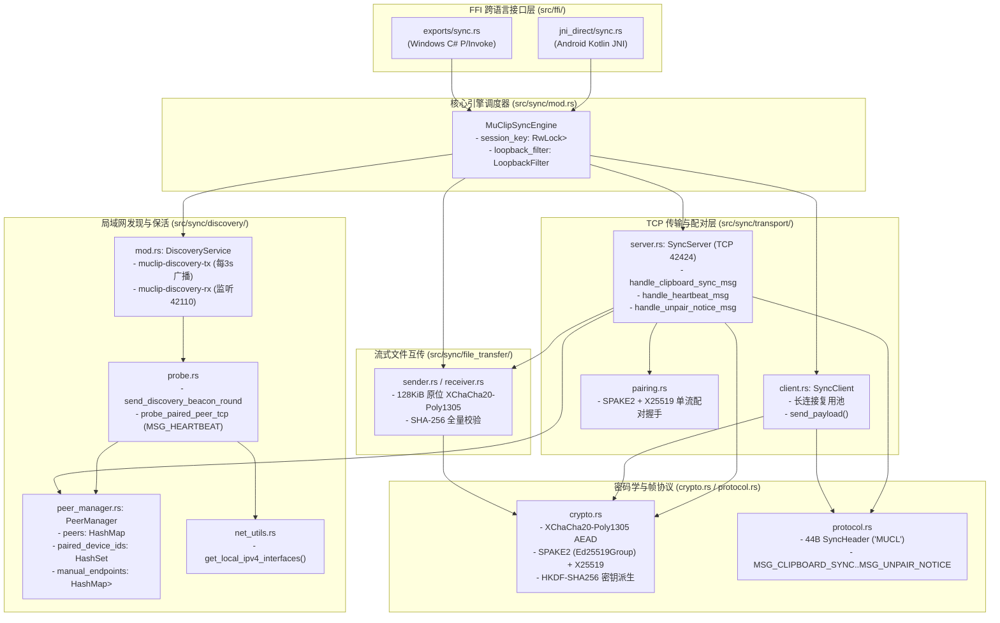

# MuClip 核心架构与功能速查索引 (Architecture & Modification Index)

本文档是 **MuClip 核心库（Rust）** 的源码导航地图。当需要修改网络发现、配对握手、加解密、剪贴板同步或文件传输时，可直接按本索引定位到具体文件与函数。

> Android 与 Windows 客户端是各自独立仓库的集成方，不在本索引覆盖范围内——它们的接入方式见 README 的「关联仓库」。

---

## 一、「我要改什么 -> 改哪个文件」速查表

| 需求场景 / 故障现象 | 所在仓库 | 目标文件 | 关键结构体 / 函数 |
| :--- | :--- | :--- | :--- |
| **修改局域网 UDP 广播频率 / 后台心跳周期** | `MuClip` (Rust) | [`src/sync/discovery/mod.rs`](../src/sync/discovery/mod.rs) | `DiscoveryService::start` (`muclip-discovery-tx` 线程、`muclip-discovery-rx` 单播回包节流) |
| **修改 UDP 广播包发送逻辑 / TCP 心跳探测** | `MuClip` (Rust) | [`src/sync/discovery/probe.rs`](../src/sync/discovery/probe.rs) | `send_discovery_beacon_round`、`probe_paired_peer_tcp`、`probe_manual_peer_tcp`、`connect_tcp_lan_aware` |
| **修改设备在线判定超时时间 / 配对状态内存表** | `MuClip` (Rust) | [`src/sync/discovery/peer_manager.rs`](../src/sync/discovery/peer_manager.rs) | `PEER_TIMEOUT_SECS` (30s)、`PeerManager::update_peer`、`upsert_incoming_peer`、`prune_stale_peers` |
| **修改多网卡 / 虚拟网卡过滤规则** | `MuClip` (Rust) | [`src/sync/discovery/net_utils.rs`](../src/sync/discovery/net_utils.rs) | `get_local_ipv4_interfaces`、`is_virtual_or_tunnel_interface`、`create_discovery_rx_socket` |
| **修改剪贴板广播并发推送逻辑** | `MuClip` (Rust) | [`src/sync/mod.rs`](../src/sync/mod.rs) | `MuClipSyncEngine::broadcast_clipboard` |
| **修改 TCP 服务端收包分发 / 配对鉴权拦截** | `MuClip` (Rust) | [`src/sync/transport/server.rs`](../src/sync/transport/server.rs) | `handle_client`、`handle_clipboard_sync_msg`、`handle_heartbeat_msg`、`handle_unpair_notice_msg` |
| **修改 TCP 客户端连接池 / 超时时间** | `MuClip` (Rust) | [`src/sync/transport/client.rs`](../src/sync/transport/client.rs) | `SyncClient::send_payload`、`send_unpair_notice`、`test_peer_latency` |
| **修改 PIN 配对握手流程 (SPAKE2 + X25519)** | `MuClip` (Rust) | [`src/sync/transport/pairing.rs`](../src/sync/transport/pairing.rs) | `request_pair` (发起方)、`handle_incoming_pair_request` (接收方)、`respond_pair` |
| **修改加密算法 / 密钥派生 (HKDF / XChaCha20)** | `MuClip` (Rust) | [`src/sync/crypto.rs`](../src/sync/crypto.rs) | `derive_key`、`Spake2InitiatorSession`（发起方）、`spake2_responder_exchange`（响应方）、`derive_long_term_key`（配对密钥派生）、`derive_bulk_key`、`encrypt_in_place_with_aad` |
| **修改二进制网络协议头 / 消息类型定义** | `MuClip` (Rust) | [`src/sync/protocol.rs`](../src/sync/protocol.rs) | `SyncHeader` (44B 帧头，Magic=MUCL)、`MSG_*` 常量、`encode_packet` / `decode_packet_in_place` |
| **修改文件发送切片 / 加密流控** | `MuClip` (Rust) | [`src/sync/file_transfer/sender.rs`](../src/sync/file_transfer/sender.rs) | `FileTransferManager::send_file_internal` (128 KiB 分块 + SHA-256 终帧) |
| **修改文件接收落盘缓冲 / `.tmp` 原子重命名** | `MuClip` (Rust) | [`src/sync/file_transfer/receiver.rs`](../src/sync/file_transfer/receiver.rs) | `FileTransferManager::handle_incoming_file_stream` (1 MiB `BufWriter`) |
| **修改 Windows C# 调用的 C ABI 接口** | `MuClip` (Rust) | [`src/ffi/exports/sync.rs`](../src/ffi/exports/sync.rs) | `muclip_sync_*` 系列导出函数 |
| **修改 Android Kotlin 调用的 JNI 接口** | `MuClip` (Rust) | [`src/ffi/jni_direct/sync.rs`](../src/ffi/jni_direct/sync.rs) | `Java_com_muclip_core_MuClipNative_native*` 系列导出函数 |

---

## 二、Rust 核心网络与加密模块全景图 (`src/sync/`)



---

## 三、核心通信与加密流程详解

### 1. 局域网设备发现与在线保活 (`src/sync/discovery/`)
- **双通道 UDP 广播 + 单播 (`probe.rs` -> `send_discovery_beacon_round`)**：
  1. 后台线程 `muclip-discovery-tx` 每 **3 秒**执行一轮：
     - 向 `224.0.0.251:42110`（组播）、`255.255.255.255:42110`（受限广播）以及通过 `net_utils::get_local_ipv4_interfaces()` 枚举出的每个物理网卡子网广播地址（如 `192.168.1.255:42110`）发送 `DiscoveryBeacon` JSON 信标。
     - 同时向 `PeerManager` 中所有已知 IP 的**已配对设备**和**静态端口映射节点**发送点对点 UDP 单播。
  2. **防风暴单播回应 (`discovery/mod.rs` -> `muclip-discovery-rx`)**：
     - 监听 `0.0.0.0:42110`。收到对端非回包信标（`!beacon.is_reply`）时，调用 `peer_mgr.update_peer` 刷新在线状态与 IP，并向源 IP 单播回发一个 `is_reply = true` 的信标（同一 IP 节流间隔 1 秒）。
  3. **TCP 心跳兜底 (`probe.rs` -> `probe_paired_peer_tcp`)**：
     - 当路由器隔离 UDP 广播或手机处于息屏省电模式导致超过 5 秒未收到已配对设备的 UDP 包时，自动向对端 TCP `42424` 端口发送 `MSG_HEARTBEAT (1)` 双向交换 `DiscoveryBeacon`。
  4. **超时离线判定 (`peer_manager.rs` -> `PEER_TIMEOUT_SECS = 30`)**：
     - 已配对设备连续 30 秒无任何 UDP 信标且无 TCP 响应时标记为 `is_online = false`。

### 2. 密码学与配对体系：两两独享双边密钥（Pairwise Key: $K_{AB}, K_{BC}, K_{AC}$）(`pairing.rs` / `crypto.rs` / `peer_manager.rs`)
- **零全局主密钥暴露、两两安全完全隔离**：
  1. **SPAKE2 + X25519 直接派生 256-bit 双边密钥**：
     - 当任意两台设备（如 $A$ 和 $B$）通过 6 位一次性 PIN 配对时，双方基于 **SPAKE2 (`Ed25519Group`) + X25519** 握手直接派生出高强度的 256-bit 专属对称密钥 $K_{AB}$。
     - $A$ 仅将其保存为 `peer_keys["B"] = K_AB`；$B$ 仅将其保存为 `peer_keys["A"] = K_AB`。
     - **每台设备无需生成或维护全局暴露的 `long_term_key`**；后续 $A$ 与 $C$ 配对时派生的是完全独立的 $K_{AC}$，绝对不会触碰或影响已有的 $K_{AB}$。
  2. **解绑彻底失明**：
     - 如果某天 $A$ 解绑了 $B$，只有 $K_{AB}$ 被销毁。因为 $B$ 从未接触过 $K_{AC}$ 或 $K_{BC}$，$B$ 在局域网中就算监听抓包也无法解密 $A \leftrightarrow C$ 之间的任何剪贴板与文件流量。
  3. **去除受信任介绍人的密钥共享**：
     - 局域网广播信标仅传递基础设备在线状态（设备名、类型、端口），不夹带任何第三方密钥，避免跨设备越权解密。

### 3. 剪贴板同步与直接端到端直连链路 (`src/sync/mod.rs` -> `client.rs` -> `server.rs`)
- **严格直接点对点传输（Direct P2P Only，零自动中继、零跳跃数据泄露）**：
  - **消息级标识 `msg_id` (UUID v7)**：
    - 每条剪贴板消息由发起方生成一个全局唯一且时间有序的 `msg_id`（UUID v7），用于日志追踪、审计及基于 `LoopbackFilter` 的精准去重。
  - **固定身份标识 `device_id`**：
    - 每台设备保持唯一的 `device_id`，用于配对鉴权与网络路由定位。
  - **全量数据帧 16 字节包头 AAD 密码学绑定（Frame Header AAD Binding）**：
    - 剪贴板、心跳与握手帧在通过 XChaCha20-Poly1305 加密时，将 44 字节包头的前 16 字节（`[Magic: 4B | Version: 1B | MsgType: 1B | Flags: 2B | Sequence: 8B]`）显式注入 Poly1305 作为 AAD。
    - 局域网内任何攻击者若企图篡改明文包头里的消息类型（如篡改 `msg_type` 冒充心跳包）或序号（篡改 `sequence` 试图绕过重放过滤），解密端 Poly1305 验签会立即失败并直接丢弃，彻底消除类型混淆与序号篡改隐患。
  - **发送端并发直发**：
    - 设备 $A$ 复制文本时，遍历自身所有的在线已配对节点（如 $B$ 与 $C$），使用每个节点专属的双边密钥（$K_{AB}, K_{AC}$）并发直推给目标节点。
  - **接收端落库后绝不转发**：
    - 节点 $B$ 收到来自 $A$ 的消息后，仅验证 $K_{AB}$ 并写入本地系统剪贴板。
    - **严禁向自己的其他已配对节点（如 $B$ 另外配对的第三方设备 $D$）中继转发**！
    - 这样彻底消除了“一人配对，密码/剪贴板全网无感知扩散”的严重安全漏洞与多跳回环风险。
  - **Android 端安全策略**：Android 处于后台收到推送时**不直接调用 `setPrimaryClip`**，而是写入 SQLite 数据库并登记 `SyncEventManager.pendingClipboardWrite`，待用户切回前台获焦（`MainActivity.onResume` / `onWindowFocusChanged`）时再自动写入系统剪贴板。

### 4. 高速流式文件互传 (`src/sync/file_transfer/`)
- **Android -> PC（发送）**：Android 客户端在 Kotlin 侧用 SAF `ContentResolver` 流式读取，经 JNI 调用 `NativeXChaCha20Poly1305Aead` 原位加密 128 KiB 分块后直发。**该发送路径由客户端自行实现，不在本库内**——引用它是为了说明收发两个方向并不对称。
- **PC -> Android / PC -> PC（接收与 PC 发送）**：全链路走 Rust [`sender.rs`](../src/sync/file_transfer/sender.rs) 与 [`receiver.rs`](../src/sync/file_transfer/receiver.rs)：
  - 握手帧 `MSG_FILE_OFFER (10)` 携带 `stream_salt (16B)`，双方通过 `derive_bulk_key(session_key, &stream_salt)` 派生单文件专属密钥。
  - 握手完成后在同一 TCP 流上连续发送裸 AEAD 数据块（无 44B 帧头），每块使用确定性递增 Nonce（`[stream_salt: 16B][chunk_index: 8B BE]`）和 57 字节上下文 AAD 进行原位加解密。
  - 接收端使用 1 MiB `BufWriter` 写入 `.tmp` 临时文件，收到 `MSG_FILE_FINISH (13)` 并校验总块数、总字节数及全文件 SHA-256 完全一致后，才原子重命名为最终文件并回发 `"OK"`。

---

## 四、跨平台编译与同步更新标准流程

每次修改了 `src/` 下的 Rust 代码后，按以下顺序执行即可同步到 Windows 与 Android 两端。

> 下文 `<repo>` 指本仓库根目录，`<MuClip-Android>` 指 Android 客户端的本地路径。请替换为你自己的目录。

```powershell
# 1. 运行单元测试并编译 Windows DLL
cd <repo>
cargo test --lib
cargo build --release

# 2. 编译 Android arm64-v8a 原生库并自动拷贝到 <MuClip-Android>/app/src/main/jniLibs
cargo ndk -t arm64-v8a -o <MuClip-Android>\app\src\main\jniLibs build --release

# 3. 同步更新 Windows 端 muclip_core.dll
Copy-Item -Force target\release\muclip_core.dll dist\muclip_core.dll
Copy-Item -Force target\release\muclip_core.dll dist\windows-x86_64\muclip_core.dll

# 4. 在 <MuClip-Android> 下打包 APK
cd <MuClip-Android>
.\gradlew.bat assembleDebug assembleRelease
```
