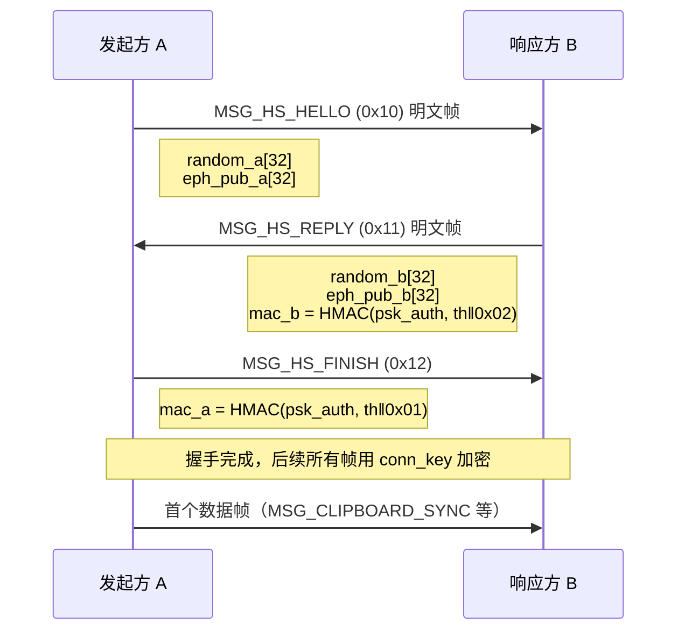

# 连接级临时 ECDH 握手设计（PFS v2）

> 目标：传输流量使用**每条 TCP 连接一次性**的密钥；长期的两两预共享密钥（PSK）退化为**纯认证材料**，不再参与数据加密。
>
> 状态：设计稿，未实现。协议版本将从 `1` 升为 `2`，与旧客户端不兼容。

---

## 一、为什么要改

当前实现里，数据密钥是静态的：

| 路径 | 现有密钥 |
| :--- | :--- |
| 短消息 | 静态两两密钥 + 每帧随机 nonce |
| 文件 | `bulk_key = derive_bulk_key(静态密钥, stream_salt)` |

`stream_salt` 本身就在用静态密钥加密的 `MSG_FILE_OFFER` 里，因此静态密钥泄露 ⇒ 历史文件全部可解。详见 `tests/file_key_forward_secrecy.rs`。

改成连接级临时密钥后：**临时私钥用完即毁 → 长期密钥即使泄露，也推不出历史连接的密钥。**

---

## 二、密钥分层

```
                      ┌─ 永久层（落盘，可跨重启）──────────────┐
                      │  PSK_AB = SPAKE2 配对派生的两两密钥     │
                      │  用途：仅做握手认证，不再加密数据        │
                      └────────────────┬───────────────────────┘
                                       │ 参与 HKDF（见 §四）
                      ┌────────────────▼───────────────────────┐
                      │  连接层（仅内存，连接关闭即销毁）        │
                      │  eph_a / eph_b：X25519 临时密钥对        │
                      │  conn_key = 32B，本连接全部帧使用        │
                      └────────────────────────────────────────┘
```

关键约束：**不存在任何从 PSK 直接推出 `conn_key` 的代码路径**。这是 PFS 的定义，也是验收标准。

---

## 三、握手流程



设计要点：

- **握手帧本身不加密**，因为此时还没有 `conn_key`（鸡生蛋问题）。它们的机密性不重要，**完整性与身份**由 `mac_a` / `mac_b` 保证。
- **两帧即可完成**：B 的 `MSG_HS_REPLY` 可以携带 `mac_b`，A 收到后校验、算出 `conn_key`，然后发 `MSG_HS_FINISH` 带 `mac_a`。B 校验后进入数据阶段。A 可以把自己的 `mac_a` 附带在首个数据帧前（省一次往返的一半），但保持独立帧更简单。
- **首帧数据失败即断开**：不重试、不回落。

---

## 四、密钥派生

```text
th  = SHA256( "MuClip-HS-v2" ‖ ver ‖ role ‖ id_a ‖ id_b
              ‖ random_a ‖ random_b ‖ eph_pub_a ‖ eph_pub_b )

dh  = X25519(eph_priv_self, eph_pub_peer)          // 32B

psk_auth = HKDF-SHA256( ikm = PSK_AB,  salt = th, info = "muclip-hs-auth-v2" )
ikm      = dh ‖ PSK_AB                             // 64B，两者拼接
conn_key = HKDF-SHA256( ikm = ikm,     salt = th, info = "muclip-conn-v2" )

mac_a = HMAC-SHA256(psk_auth, th ‖ 0x01)
mac_b = HMAC-SHA256(psk_auth, th ‖ 0x02)
```

每个字段都不可省：

| 字段 | 防的是什么 |
| :--- | :--- |
| `id_a` / `id_b` | 身份错绑（unknown key-share）：攻击者让 A 以为在跟 B 通信，实际连的是 C |
| `role` | 反射攻击：把 A 发出的 HELLO 原样回给 A |
| `random_a` / `random_b` | 重放：录下整段握手在以后重放 |
| 双方 `eph_pub` | 中间人替换公钥 |
| `ver` | 跨版本降级 |
| `PSK_AB` 进 `ikm` | 纵深防御：PSK 与 DH 任一安全，`conn_key` 就安全 |

> **不要只把 PSK 用作 MAC 而不用进 IKM。** 只做 MAC 时，一旦 PSK 泄露，任何能被动抓包的人在 DH 被攻破后即可解密；混进 IKM 的成本是零，收益是双保险。

---

## 五、Zeroize 要求

需要新增依赖：

```toml
x25519-dalek = { version = "3.0", features = ["static_secrets", "zeroize"] }
zeroize = { version = "1", features = ["derive"] }
```

必须显式擦除的值：

| 值 | 擦除时机 |
| :--- | :--- |
| `eph_priv`（发起/响应） | DH 计算完成后立即（`x25519_dalek::EphemeralSecret` 消费式 API 天然保证） |
| `dh` 共享密钥 | 派生完 `conn_key` 后立即 |
| `ikm`（64B 拼接缓冲） | 同上 |
| `psk_auth` | MAC 校验完成后 |
| `conn_key` | **连接关闭时**（这是最容易漏的一个） |

Rust 实现注意事项：

1. 用 `ZeroizeOnDrop` 包一层 `ConnKey` 结构体，而不是到处手动调 `zeroize()`。
2. 禁止给任何含密钥的结构体 `#[derive(Debug)]` —— `{:?}` 进日志就等于泄露。
3. `Vec<u8>` 扩容会留下旧的堆副本；密钥缓冲一律用固定长度数组 `[u8; 32]` / `[u8; 64]`。
4. `std::hint::black_box` / `compiler_fence` 不是必须的，`zeroize` 已经处理了编译器优化消除。

---

## 六、失败处理（这条最容易做错）

任何一步不通过都必须**硬失败**：

| 情况 | 行为 |
| :--- | :--- |
| `mac_b` / `mac_a` 校验失败 | 关闭连接，返回 `HandshakeAuthFailed` |
| 握手超时（建议 3s） | 关闭连接，返回 `HandshakeTimeout` |
| 收到版本 1 的帧 | 回 `ERR_VERSION_UNSUPPORTED` 并关闭 |
| 找不到该 peer 的 PSK | 关闭连接，返回 `PeerKeyMissing` |

**禁止**：握手失败后回落到静态 `session_key` 重试。当前 `get_candidate_keys()` 那套"遍历候选密钥直到解开为止"的逻辑，在 v2 里必须从数据帧路径移除 —— 否则攻击者可以诱导降级，PFS 变成纸面承诺。

---

## 七、影响面

| 位置 | 影响 |
| :--- | :--- |
| `transport/server.rs::handle_client_connection` | 循环开头插入握手阶段，全部 5 个 msg_type 分支之后才能进入 |
| `transport/client.rs::send_payload` | 建连后先握手，`conn_key` 随连接存入 `connection_pool`（现在是 `Arc<Mutex<TcpStream>>`，要改成 `(stream, conn_key)`） |
| `file_transfer/sender.rs` | 每次发文件新建连接 → 每次多 1 个 RTT；`FILE_OFFER` 改用 `conn_key` 而非 `session_key` |
| `discovery/probe.rs::probe_paired_peer_tcp` | 心跳探测也走 TCP；要么也握手（发现流量 +2 帧），要么定义独立的**明文探测帧**（只含设备元数据，明确不保密） |
| `peer_manager.rs::get_candidate_keys` | 数据路径弃用；握手阶段只允许"该 peer 精确对应的一把 PSK" |
| **`MuClip-Android`** | `StreamingFileTransfer.kt` 从 `nativeGetBulkSessionKey()` 取密钥自行加密 → 必须改为"先握手拿 `conn_key`"，或把文件发送整体移到 Rust |

---

## 八、兼容性

- `SyncHeader.version` 从 `1` 升到 `2`。
- 两端必须同时升级；`version == 1` 的连接直接拒绝，不做双栈协商（项目仍在 `0.x`，双栈维护成本不划算）。
- PSK 的落盘格式不变（仍是 64 位 hex，走六段式 `add_paired_device`）。

---

## 九、验收测试清单

| # | 用例 | 期望 |
| :--- | :--- | :--- |
| 1 | 正常握手 + 首帧数据 | 通过 |
| 2 | 篡改 `eph_pub_b` | `mac_b` 失败，连接关闭 |
| 3 | 重放上一轮的完整握手 | 失败（`random` 新鲜性） |
| 4 | 反射：把 A 的 HELLO 回给 A | 失败（`role` + `id` 绑定） |
| 5 | 用 A↔B 的 PSK 与 C 握手 | 失败（PSK 逐对隔离） |
| 6 | 同一对设备连续两次连接 | 两次 `conn_key` **不同**（PFS 的结构性证据） |
| 7 | 泄露 PSK + 历史密文 | 无法解密（无 PSK→`conn_key` 路径） |
| 8 | 握手半包 / 超时 | 连接关闭，无状态泄漏 |

第 6 条是最直观的回归防线：只要有人把 `conn_key` 改回从 PSK 派生，它就立刻失败。

---

## 十、代价

- **每连接 +1 RTT**。剪贴板走连接池复用，摊薄后可忽略；发文件本来每次新建连接，每次多 1 个 RTT。
- **连接生命周期就是密钥生命周期**。服务端 `read_timeout` 是 300s，意味着一条池化连接最多存活 5 分钟 —— 这就是单个 `conn_key` 的最大暴露窗口。想更短就加空闲超时或定期 `KeyUpdate`。
- **PFS 只保护"过去"**。当前连接被攻破仍然暴露当前连接的内容；且如果攻击者持 PSK 且能在握手时主动介入，认证拦不住它，只能让它付出被发现（MAC 失败）的代价。
